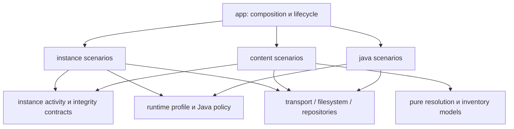

# Аудит архитектуры launcher/core

Дата: 17 ноября 2026. Объект: `/home/quartix/Projects/launcher/core`.

## Вывод

Главная проблема ядра — незавершённый переход между несколькими архитектурами. Одновременно существуют старые `LibsData`/`LaunchInfo`, новые `InstalledProfile`/`artifacts`, отдельная подсистема управляемой Java и новая подсистема контента. Они повторяют транспорт, кеширование, задачи, отмену и файловые операции, но обеспечивают разные гарантии. Правила целостности зависят от выбранного пути исполнения.

Контент усилил существующие зависимости в обе стороны и добавил несогласованность между учётом файлов, восстановлением и жизненным циклом экземпляра. Сначала нужно исправить эти инварианты, затем переносить модули.

Хорошие решения тоже есть: wire DTO скрыты внутри адаптеров; solver отделён от HTTP; новые файлы публикуются без перезаписи; установка принадлежит ядру, а не времени жизни UI future; у каталога версий есть single-flight и проверяемый дисковый кеш. Их следует сохранить.

## Методика, охват и ограничения

Инвентаризированы **178 Rust-файлов, 23 179 строк**, восемь SQL-миграций, Cargo-манифест, объявления модулей, текущий Git diff и тестовая структура. Обзор охватывает `data`, `bus`, `instance`, `java`, `modloader`, `version`, `utils` и CLI. Детально прослежены создание/установка/запуск экземпляров, установка и recovery контента, выбор/установка Java, transport, кеши и публикация файлов. Найдены также файлы вне дерева модулей.

Это статический архитектурный аудит с выборочными воспроизведениями, не доказательство отсутствия всех ошибок. Глубина ручной проверки разных файлов различалась; инвентарь всех файлов приведён в приложении. Реальные API провайдеров, Windows/macOS и аварийное отключение питания не проверялись. GUI не является самостоятельным объектом этого аудита. Исходники и данные приложения не изменялись; `.env` и пользовательская БД не читались.

HEAD ядра: `4b445ba` (`feat(forge): stream processor logs`). Контент и связанные изменения **не закоммичены**. Выводы относятся к рабочему дереву, а не только к HEAD. Номера строк и SHA файлов фиксируют проверенную версию.

Проверки:

- `cargo fmt --check` — успешно.
- `SQLX_OFFLINE=true CARGO_TARGET_DIR=/tmp/launcher-core-audit-target cargo check --locked --offline` — остановлен до проверки ядра на `openssl-sys 0.9.109`: установленная OpenSSL не поддерживается этой версией зависимости. Это ограничение среды, не доказанная ошибка исходников ядра. Лог: `/tmp/launcher-core-audit-check.log`.
- Полные `cargo test` и `cargo build` не выполнялись из-за того же dependency blocker. Успешность полной сборки/тестов не утверждается.
- Временный Rust harness подключил **исходные** `utils/files` и `utils/cancellation` через `#[path]`, без HTTP/OpenSSL. **13 тестов прошли**: 11 подключённых тестов файловых модулей и два новых наблюдательных воспроизведения. Они подтверждают существующее нежелательное поведение, а не исправление. Лог: `/tmp/launcher-core-audit-harness.log`.
- Все миграции последовательно применены в новой SQLite `:memory:` через Python. Проверено, что запрос assets cache возвращает запись без проверки файла.

Приоритеты: **P1** — целостность, выход за файловую границу, неверная совместимость или блокировка восстановления; **P2** — существенный архитектурный долг/неоднозначность; **P3** — локальное улучшение. «По коду» означает прослеженный сценарий без запуска приложения; «риск» — зависимость от внешних файлов/платформы/конкурентного доступа. Архитектурная рекомендация не равнозначна runtime-багу.

## Отдельно: ContentError и AppError

**Тип ошибки не перенесён в AppError.** `ContentError` объявлен в [src/instance/content/error.rs:4](/home/quartix/Projects/launcher/core/src/instance/content/error.rs:4). В [src/data/mod.rs:53](/home/quartix/Projects/launcher/core/src/data/mod.rs:53) добавлена обёртка `Content(#[from] ContentError)`, потому что `GlobalState::new` вызывает fallible-конструктор контента через `.await?`.

Само оборачивание ошибки сервиса на уровне сборки приложения допустимо. В текущем `data/mod.rs` действительно есть `LauncherServices` с полями сервисов и конструктор `GlobalState`, создающий их. Поэтому нарушение точнее формулируется так:

1. Bootstrap находится внутри `data`, который одновременно является фундаментом БД для этих же сервисов.
2. В startup error попадает весь `ContentError`: HTTP, каталог, download, SQL и пользовательские отказы, хотя конструктор делает lock/recovery/cleanup.
3. Необязательная функция стала обязательной для старта приложения; её service определяет глобальную блокировку и доступность всего launcher.

Рекомендация: composition root в `app/bootstrap`, ошибка `BootstrapError`, отдельный `ContentInitError` или типизированный статус доступности. Доменные ошибки остаются у владельцев. Если старт намеренно атомарен, `BootstrapError::ContentInit(...)` допустим. **Простое перемещение варианта в InstanceError проблему не решит.**

## 1. Границы модулей

### A01. P2 — `data` одновременно инфраструктура и сборщик приложения

**Места:** [src/data/mod.rs:43](/home/quartix/Projects/launcher/core/src/data/mod.rs:43), [src/data/db/mod.rs:10](/home/quartix/Projects/launcher/core/src/data/db/mod.rs:10), [src/lib.rs:9](/home/quartix/Projects/launcher/core/src/lib.rs:9).

`data` хранит БД/config/operations и знает конкретные сервисы. Сервисы импортируют `data` обратно. `GlobalState` дополнительно запускает фоновые задачи и выполняет `add_java`, `rediscover_java`, `validate_managed_java`.

**Последствие:** изменение инфраструктуры и прикладных сценариев связано одной широкой поверхностью, а имя `data` скрывает роль. **Рефакторинг:** `app::{Launcher, LauncherServices, BootstrapError}` для сборки и межсервисных сценариев; БД, конфигурация, paths и operations — явные инфраструктурные модули. Выделять отдельные crates сразу необязательно.

### A02. P1/P2 — InstanceService зависит от внутреннего SQL контента

**Места:** [src/instance/service.rs:420](/home/quartix/Projects/launcher/core/src/instance/service.rs:420), [src/instance/content/service.rs:42](/home/quartix/Projects/launcher/core/src/instance/content/service.rs:42), [src/instance/content/recovery.rs:24](/home/quartix/Projects/launcher/core/src/instance/content/recovery.rs:24).

Контент обращается к InstanceService за registry и mutation lease, InstanceService::launch — прямо к content::storage. Правило допуска к изменению/запуску размазано между service, SQL и content_jobs. Один сценарий уже пропустил запрет, см. B03.

**Рефакторинг:** общий `InstanceActivityCoordinator` для конфликтов launch/install/content/delete и узкий контракт проверки pending mutations. SQL скрыть за владельцем журнала. Контенту передавать чтение instance context и reservation, а не весь InstanceService.

### A03. P2 — Взаимная зависимость modloader и instance

**Места:** [src/modloader/repository.rs:1](/home/quartix/Projects/launcher/core/src/modloader/repository.rs:1), [src/modloader/error.rs:38](/home/quartix/Projects/launcher/core/src/modloader/error.rs:38), [src/modloader/jobs.rs:2](/home/quartix/Projects/launcher/core/src/modloader/jobs.rs:2), [src/instance/launch/arguments.rs:1](/home/quartix/Projects/launcher/core/src/instance/launch/arguments.rs:1).

Нейтральный repository использует instance transport; lifecycle обычной установки лежит в modloader; launch аргументы возвращают ModloaderError даже для vanilla. Общий transfer вынесен в utils, но старые пути импортов и error aliases сохраняют неправильное направление зависимости.

**Рефакторинг:** neutral transport вне instance; runtime rules/arguments со своей ошибкой; InstallJobs под instance/application lifecycle. Удалить внутреннюю зависимость на compatibility re-export.

### A04. P2 — Общая политика Java принадлежит modloader

**Места:** [src/modloader/model.rs:93](/home/quartix/Projects/launcher/core/src/modloader/model.rs:93), [src/java/select.rs:107](/home/quartix/Projects/launcher/core/src/java/select.rs:107), [src/modloader/components.rs:300](/home/quartix/Projects/launcher/core/src/modloader/components.rs:300).

Java selector зависит от modloader::JavaPolicy, а policy extraction загрузчиков — от java::JavaRequirement. Понятия нужны и vanilla. **Рефакторинг:** единая модель требований/политики в `java::policy`, разбор wire metadata в адаптерах.

### A05. P2 — SQL внутри content service

**Место:** [src/instance/content/service.rs:174](/home/quartix/Projects/launcher/core/src/instance/content/service.rs:174).

`plan_install` напрямую соединяет таблицы, вручную переводит provider в строки и проверяет count. Остальной SQL вынесен в storage. Сценарий знает схему и обходится без политики актуальности inventory.

**Рефакторинг:** repository query `installed_projects(instance)` с presence/enabled/provenance, а не сырым count. Преобразование provider — в одном persistence adapter.

### A06. P2 — Durable recovery DTO в API-модуле

**Места:** [src/instance/content/api.rs:54](/home/quartix/Projects/launcher/core/src/instance/content/api.rs:54), [src/instance/content/storage.rs:2](/home/quartix/Projects/launcher/core/src/instance/content/storage.rs:2).

PublishedFile содержит object_id и SQL-коды placement/provider, используется journal и recovery. Это persisted внутренний контракт, а не пользовательский DTO. **Рефакторинг:** `journal::model`, версия формата и валидация после deserialize; API оставить для команд/ответов сервиса.

### A07. P2 — Широкий pub API позволяет обходить service-инварианты

**Места:** [src/instance/content/mod.rs:11](/home/quartix/Projects/launcher/core/src/instance/content/mod.rs:11), [src/data/mod.rs:44](/home/quartix/Projects/launcher/core/src/data/mod.rs:44), [src/data/db/mod.rs:11](/home/quartix/Projects/launcher/core/src/data/db/mod.rs:11), [src/instance/registry.rs:106](/home/quartix/Projects/launcher/core/src/instance/registry.rs:106), [src/instance/storage.rs:14](/home/quartix/Projects/launcher/core/src/instance/storage.rs:14).

Клиент библиотеки может писать SQL/удалять через registry без activity lease, running check и recovery policy. **Рефакторинг:** определить поддерживаемый API; storage/registry/install/recovery сделать private/pub(crate). Административный доступ оформить отдельно. Удаление — прикладной сценарий, включающий остановку/блокировки и файловую политику. Перед сужением API проверить GUI/CLI и других потребителей.

### A08. P2 — Три модели задач и частично дублированные состояния

**Места:** [src/instance/content/service.rs:33](/home/quartix/Projects/launcher/core/src/instance/content/service.rs:33), [src/instance/content/api.rs:34](/home/quartix/Projects/launcher/core/src/instance/content/api.rs:34), [src/data/registry/operation/mod.rs:26](/home/quartix/Projects/launcher/core/src/data/registry/operation/mod.rs:26), [src/java/managed/mod.rs:37](/home/quartix/Projects/launcher/core/src/java/managed/mod.rs:37).

Контент одновременно хранит UUID/phase/progress/error/cancel и общий OperationId. Managed Java имеет собственные snapshots и файловые records. Общий registry хранит только активные операции, без terminal results/history.

**Рефакторинг:** общие JobId, ownership, cancellation, terminal outcome; domain phases и durable journals оставить в подсистемах. Не подменять recovery transient событиями EventBus.

### A09. P2 — Скрытая конфигурация и неверно определённая область root lock

**Места:** [src/data/mod.rs:123](/home/quartix/Projects/launcher/core/src/data/mod.rs:123), [src/instance/content/service.rs:66](/home/quartix/Projects/launcher/core/src/instance/content/service.rs:66), [src/data/config.rs:5](/home/quartix/Projects/launcher/core/src/data/config.rs:5).

Credentials читаются из env внутри composition root; CAS path зашит в контенте. Lock content-сервиса запрещает второй весь launcher с тем же root. При разных roots и одном overridden instances/DB ресурсе lock уже не соответствует области данных.

**Рефакторинг:** явные credentials/content paths; single-process policy на уровне bootstrap с согласованной identity ресурсов. При try_lock сохранять настоящий io::Error: не всякая ошибка означает другой процесс. Решить, должна ли недоступность контента запрещать вообще весь запуск.

## 2. Целостность и ошибки поведения

### B01. P1 — Missing target под escaping symlink проходит child()

**Место:** [src/utils/files/mod.rs:40](/home/quartix/Projects/launcher/core/src/utils/files/mod.rs:40). **Воспроизведено на исходной функции.**

Containment проверяется только при `full.exists()`. Для `root/link -> outside` и отсутствующего `outside/new.jar` вызов `child(root, "link/new.jar")` возвращает Ok, после чего запись попадает в outside. Существующие escaping targets тестируются, отсутствующие — нет.

**Последствие:** файловая граница не выполняется при создании новых файлов; helper используется загрузкой артефактов и ZIP extraction. **Исправление:** проверка существующих предков и явная политика symlink; для конкурентно изменяемых деревьев — directory handles/no-follow, где доступно. Canonicalize перед записью всё ещё оставляет TOCTOU. Regression: missing target, broken symlink, подмена предка.

**Наблюдение (20 ноября, этот commit):** внешний scratch-потребитель против shipped `child()` из `utils::files`: статичная проверка — 7/7 отсутствующих targets под escaping symlink отклонены обычным путём; при конкурентной подмене предка 7/7 записей физически оказались вне корня — documented window подтверждён наблюдением, исправление конкурентного пути не заявляется. Статус B01 без изменений. Локальный non-durable log: `/tmp/opencode/core-wine-evidence/e_prefix_race.log`.

### B02. P1 — Hardlink делает CAS изменяемым из экземпляра

**Места:** [src/instance/content/install.rs:128](/home/quartix/Projects/launcher/core/src/instance/content/install.rs:128), [src/utils/files/placement.rs:42](/home/quartix/Projects/launcher/core/src/utils/files/placement.rs:42), [src/instance/content/tests.rs:98](/home/quartix/Projects/launcher/core/src/instance/content/tests.rs:98). **Воспроизведено на исходной place_new.**

Запись in-place в мод экземпляра A меняет общий inode: объект CAS и мод экземпляра B. Существующий тест уже демонстрирует это свойство, но рабочий код не связывает его с quarantine/repair и проверкой перед launch. Проверка CAS перед следующим использованием не восстанавливает другие экземпляры.

**Исправление:** copy/reflink по умолчанию для изменяемых экземпляров. Hardlink — только с явно обеспеченной неизменяемостью и repair всех ссылок. Один chmod read-only не является полноценным барьером для владельца и тоже меняет permissions общего inode. Это архитектурный риск текущей политики, не ошибка реализации самой системной hardlink.

### B03. P1 — Pending content journal не блокирует обычный install

**Места:** [src/instance/service.rs:175](/home/quartix/Projects/launcher/core/src/instance/service.rs:175), [src/instance/service.rs:401](/home/quartix/Projects/launcher/core/src/instance/service.rs:401), [src/instance/content/storage.rs:11](/home/quartix/Projects/launcher/core/src/instance/content/storage.rs:11). **По коду.**

После конфликта recovery запись publishing остаётся. Launch вызывает ensure_no_pending, а install проверяет только in-memory content_jobs/running. После рестарта или завершения failed job lease освобождён — loader install разрешён. Комментарий конструктора контента обещает запрет launch/install, реализована лишь часть.

**Исправление:** единый admission guard для всех конфликтующих сценариев. Тестировать journal без in-memory job, а не только живой mutation lease.

### B04. P1 — Ошибка одного recovery блокирует остальные

**Места:** [src/instance/content/recovery.rs:28](/home/quartix/Projects/launcher/core/src/instance/content/recovery.rs:28), [src/instance/content/storage.rs:81](/home/quartix/Projects/launcher/core/src/instance/content/storage.rs:81), [src/instance/content/service.rs:70](/home/quartix/Projects/launcher/core/src/instance/content/service.rs:70). **По коду.**

`?`/return Err в цикле прерывают общий обход. Startup логирует одну ошибку и не продолжает независимые операции. pending заранее десериализует все JSON, поэтому одна повреждённая запись блокирует даже recovery с filter: фильтр применяется позже.

**Исправление:** SQL filter до чтения, разбор и recovery по операциям, RecoveryReport с isolated errors по экземплярам. Для нескольких journals одного экземпляра определить порядок/ограничение конкурентности. Тест: конфликт A и полностью восстанавливаемый B.

### B05. P1 — Нет прикладного способа разрешить RecoveryConflict

**Места:** [src/instance/content/recovery.rs:55](/home/quartix/Projects/launcher/core/src/instance/content/recovery.rs:55), [src/instance/content/service.rs:452](/home/quartix/Projects/launcher/core/src/instance/content/service.rs:452), [src/instance/content/storage.rs:13](/home/quartix/Projects/launcher/core/src/instance/content/storage.rs:13). **По коду.**

Журнал остаётся, запуск запрещён. Сервис предоставляет search/plan/start/cancel/latest_job, но не список pending recovery и команды reconcile/keep-external/abort. Startup лишь пишет log. Ручное исправление файлов может помочь, но пользовательский путь решения отсутствует.

**Исправление:** явный recovery status и команды решения конфликта с lease и верификацией. Не удалять journal автоматически при mismatch: это уничтожит описание незавершённой публикации.

### B06. P1 — Resolver не учитывает уже установленные моды

**Места:** [src/instance/content/resolve/catalog_plan.rs:10](/home/quartix/Projects/launcher/core/src/instance/content/resolve/catalog_plan.rs:10), [src/instance/content/resolve/graph.rs:141](/home/quartix/Projects/launcher/core/src/instance/content/resolve/graph.rs:141), [src/instance/content/service.rs:135](/home/quartix/Projects/launcher/core/src/instance/content/service.rs:135). **По коду.**

Solver получает roots/catalog, но не installed inventory. Если установлен X, а новый Y несовместим с X, X отсутствует в selected и конфликт не обнаружится. Последующий SQL-count смотрит только на совпадение самого выбранного project через preferred provider association. Ручной/переименованный мод не имеет достоверной provider identity.

**Исправление:** resolution против снимка установленного состояния, enabled/pinned и известных связей. Неизвестная identity должна ограничивать автоматические обещания совместимости. Тесты: installed incompatible, pinned dependency, disabled mod, неоднозначная cross-provider identity.

### B07. P1/P2 — Ошибка невыбранного кандидата обрывает весь подбор

**Места:** [src/instance/content/resolve/catalog_plan.rs:39](/home/quartix/Projects/launcher/core/src/instance/content/resolve/catalog_plan.rs:39), [src/instance/content/catalog/modrinth/mod.rs:91](/home/quartix/Projects/launcher/core/src/instance/content/catalog/modrinth/mod.rs:91), [src/instance/content/catalog/curseforge/mod.rs:105](/home/quartix/Projects/launcher/core/src/instance/content/catalog/curseforge/mod.rs:105). **По коду.**

До solver собираются зависимости всех кандидатов. Exact dependency старого кандидата может быть несовместима/недоступна; normalize одного CF-файла может отказать из-за запрета автоматической загрузки. В обоих случаях Err возвращается до backtracking, хотя существует другой пригодный кандидат. Лимит 128 visited project/exact не учитывает дополнительные HTTP-запросы внутри Modrinth normalize.

**Исправление:** разделить candidate-local rejection и отказ провайдера целиком; lazy enrichment либо исключение непригодного кандидата с диагностикой. Общий request budget и кеш exact responses. Не превращать сетевой сбой в «нет совместимых версий».

### B08. P1 — CurseForge exact release не проверяет loader

**Места:** [src/instance/content/catalog/curseforge/mod.rs:108](/home/quartix/Projects/launcher/core/src/instance/content/catalog/curseforge/mod.rs:108), [src/instance/content/catalog/curseforge/dto.rs:37](/home/quartix/Projects/launcher/core/src/instance/content/catalog/curseforge/dto.rs:37). **По коду; живой API не проверялся.**

Обычный список фильтруется параметром modLoaderType. Exact endpoint проверяет только game_versions/Minecraft; DTO не выделяет проверяемую loader identity. Один MC version не доказывает пригодность для Fabric/Forge/NeoForge. Exact/list также различаются правилами release_type.

**Исправление:** единая provider-specific compatibility function для обоих путей; при недостатке exact metadata подтвердить релиз через отфильтрованный список/дополнительные metadata. Отдельно определить политику beta/alpha exact dependencies. Fixtures: одинаковый MC, разные loaders, unstable exact release.

### B09. P1 — Проверка Java перед launch закомментирована

**Места:** [src/instance/launch/resolved.rs:41](/home/quartix/Projects/launcher/core/src/instance/launch/resolved.rs:41), [src/instance/service.rs:527](/home/quartix/Projects/launcher/core/src/instance/service.rs:527). **По коду.**

resolve_java проверяет наличие записи, но не major/arch. Проверка профиля отключена комментариями. Автовыбор не защищает от ручного выбора runtime через настройки.

**Исправление:** проверка в общем launch preparation и typed IncompatibleRuntime. Если нужен diagnostic override, сделать явную опцию, а не отключённый код.

### B10. P1/P2 — Assets cache доверяет БД, не файлу

**Места:** [src/instance/download/assets/storage.rs:26](/home/quartix/Projects/launcher/core/src/instance/download/assets/storage.rs:26), [src/instance/download/sync.rs:103](/home/quartix/Projects/launcher/core/src/instance/download/sync.rs:103), [src/instance/download/libs/storage.rs:117](/home/quartix/Projects/launcher/core/src/instance/download/libs/storage.rs:117). **По коду и проверке SQLite-запроса.**

Assets cached возвращает hashes из таблицы, libraries cached проверяет actual bytes. После удаления/порчи assets повторная установка пропускает загрузку. Artifacts::finish проверяет библиотеки, а не asset objects.

**Исправление:** различать «известен в БД» и «присутствует/проверен». Минимум presence/size, full repair — hash. Тесты: строка в БД + удалённый/повреждённый файл.

### B11. P1/P2 — Assets hash не валидируется перед slicing/path join

**Места:** [src/instance/download/assets/parse.rs:14](/home/quartix/Projects/launcher/core/src/instance/download/assets/parse.rs:14), [src/instance/download/assets/mod.rs:98](/home/quartix/Projects/launcher/core/src/instance/download/assets/mod.rs:98). **По коду.**

Ожидается 40 ASCII hex, проверяется лишь len≥2. Unicode может вызвать panic на `&hash[..2]`; разделители попадают в path/URL. Неверные короткие записи молча пропускаются, отчего manifest выглядит обработанным.

**Исправление:** один Sha1Digest/hash_valid(40) до всех slices/join; явная ошибка invalid manifest. Fixtures: Unicode, slash, absolute path, короткий/неверный hex.

### B12. P2 — Watcher/identity policy не подключены к рабочему индексатору

**Места:** [src/instance/content/watch.rs:10](/home/quartix/Projects/launcher/core/src/instance/content/watch.rs:10), [src/instance/content/scan_policy.rs:16](/home/quartix/Projects/launcher/core/src/instance/content/scan_policy.rs:16), [migrations/0008_content.sql:15](/home/quartix/Projects/launcher/core/migrations/0008_content.sql:15), [src/instance/content/storage.rs:49](/home/quartix/Projects/launcher/core/src/instance/content/storage.rs:49).

По ссылкам внутри ядра watcher и identity policy используются только в определениях и тестах. Нет production coordinator scan→identity→reconcile→launch gate. Установка добавляет связи, но не поддерживает presence/generation/metadata после ручных изменений. Значительная часть схемы — заготовка.

**Последствие:** структура БД выглядит как актуальный inventory, но не отражает диск, а запрет другой версии проекта уже доверяет ей. **Рефакторинг:** либо довести индексатор до сквозного сценария, либо явно отделить будущую модель от install journal. Тесты helper-функций не означают интеграцию feature.

### B13. P2 — Найденный existing file не получает provenance

**Места:** [src/instance/content/service.rs:191](/home/quartix/Projects/launcher/core/src/instance/content/service.rs:191), [src/instance/content/storage.rs:49](/home/quartix/Projects/launcher/core/src/instance/content/storage.rs:49).

Файл с совпадающим именем/digest исключается из releases, а только releases идут в execute/PublishedFile/БД. Если всё уже есть на диске, start_install отказывает «всё установлено». Provider identity найденного вручную файла не сохраняется.

**Следствие:** preview считает файл установленным, project-check БД его не знает, другой filename/release можно поставить рядом. **Исправление:** actions AdoptExisting/Download/NoOp, adoption с повторной верификацией и транзакцией.

### B14. P2 — Удалённый вручную мод продолжает блокировать reinstall

**Место:** [src/instance/content/service.rs:174](/home/quartix/Projects/launcher/core/src/instance/content/service.rs:174).

Count не проверяет presence и реальность relative_path. После удаления старого JAR установка релиза с другим именем получает existing>0 и отказ. **Исправление:** reconcile до планирования и проверка реально активной версии. Это отдельный пользовательский сценарий проявления B12.

### B15. P2 — Signature является слабым несогласованным snapshot

**Места:** [src/instance/content/inventory.rs:140](/home/quartix/Projects/launcher/core/src/instance/content/inventory.rs:140), [src/utils/files/digest.rs:22](/home/quartix/Projects/launcher/core/src/utils/files/digest.rs:22), [src/instance/content/service.rs:195](/home/quartix/Projects/launcher/core/src/instance/content/service.rs:195).

Name/len/mtime не включают inode/ctime/content, хотя FileStamp уже сильнее. Проверки existing targets и signature происходят в разные моменты; внешний writer может заменить файл между ними/сохранить size+mtime. Watcher не участвует.

**Статус:** риск concurrency; no-clobber всё ещё защищает новые targets от перезаписи, поэтому это не доказательство гарантированной потери данных. **Исправление:** единый versioned snapshot с проверенными identities и повторная validation при commit; определить допустимые внешние изменения.

### B16. P2 — Atomic publish не означает durability при power loss

**Места:** [src/utils/files/publish.rs:6](/home/quartix/Projects/launcher/core/src/utils/files/publish.rs:6), [src/instance/content/store/mod.rs:93](/home/quartix/Projects/launcher/core/src/instance/content/store/mod.rs:93), [src/instance/content/storage.rs:49](/home/quartix/Projects/launcher/core/src/instance/content/storage.rs:49), [src/utils/files/mod.rs:100](/home/quartix/Projects/launcher/core/src/utils/files/mod.rs:100).

Файлы местами sync_all, но parent directories после link/persist/rename не синхронизируются. SQLite может сохранить completed и journal cleanup раньше, чем гарантирована устойчивость directory entries.

**Статус:** риск по последовательности операций; power-cut эксперимент не выполнялся. **Исправление:** определить гарантию process crash vs power failure, нужный порядок fsync файлов/директорий/SQL commit и проверку completed ссылок. Не называть rename полноценной FS+SQL транзакцией.

### B17. P2 — Recovery записывает запланированный placement вместо фактического

**Места:** [src/instance/content/recovery.rs:70](/home/quartix/Projects/launcher/core/src/instance/content/recovery.rs:70), [src/instance/content/storage.rs:67](/home/quartix/Projects/launcher/core/src/instance/content/storage.rs:67).

Результат place_new при recovery отбрасывается; complete пишет placement из журнала. При изменившихся условиях hardlink может стать copy. Совпадающий existing file принимается по hash без проверки placement.

**Исправление:** фиксировать фактический результат или unknown/external; не выдавать план размещения за наблюдаемый факт.

## 3. Дублирование и расхождение реализаций

### D01. P2 — Три streaming downloader

**Места:** [src/utils/download/mod.rs:131](/home/quartix/Projects/launcher/core/src/utils/download/mod.rs:131), [src/utils/download/transfer/mod.rs:38](/home/quartix/Projects/launcher/core/src/utils/download/transfer/mod.rs:38), [src/java/managed/transfer.rs:58](/home/quartix/Projects/launcher/core/src/java/managed/transfer.rs:58).

Повторяются redirects, status, chunk read, timeout, hashing, запись и commit, но гарантии различаются:

| Свойство | Download<T> | transfer::download | Managed Java |
|---|---|---|---|
| Digest | SHA-1 | SHA-1 | SHA-256 |
| Retry | снаружи в Syncer | 3 попытки внутри | отдельной retry-петли нет |
| Отмена | отсутствует | atomic polling между awaits | future против сигнала |
| Size limit | общего нет | жёсткие 2 GiB | ожидаемый размер пакета |
| HTTPS на redirects | не навязывается | не навязывается | каждая итерация |
| Bytes progress | нет | нет | есть |

**Рефакторинг:** общий streaming engine с request policy: checksum/expected_size/max_size/redirects/retry/cancellation и progress observer. Доменные адаптеры задают политику. Нельзя унифицировать на самом слабом варианте. `instance/download/transfer.rs` уже только re-export: это compatibility shim, **не копия реализации**.

### D02. P2 — Пять похожих JSON/bytes transport

**Места:** [src/utils/download/mod.rs:46](/home/quartix/Projects/launcher/core/src/utils/download/mod.rs:46), [src/utils/download/json/mod.rs:36](/home/quartix/Projects/launcher/core/src/utils/download/json/mod.rs:36), [src/instance/download/http.rs:5](/home/quartix/Projects/launcher/core/src/instance/download/http.rs:5), [src/version/transport.rs:25](/home/quartix/Projects/launcher/core/src/version/transport.rs:25), [src/java/managed/catalog.rs:130](/home/quartix/Projects/launcher/core/src/java/managed/catalog.rs:130).

Повторяются timeout/status/body limit/deserialize. Старый download_in_json не проверяет HTTP status и не ограничивает body; managed catalog имеет отдельные правила, новый JsonClient используется контентом. 429 с JSON в разных путях может стать HTTP error или ошибкой схемы/данными.

**Рефакторинг:** общий bounded transport, отдельно decode; разные лимиты и особое 404→empty остаются provider policy. Не переносить provider DTO в инфраструктуру.

### D03. P2 — Три cancellation type и утечка atomic representation

**Места:** [src/utils/cancellation.rs:7](/home/quartix/Projects/launcher/core/src/utils/cancellation.rs:7), [src/utils/download/transfer/mod.rs:22](/home/quartix/Projects/launcher/core/src/utils/download/transfer/mod.rs:22), [src/java/managed/transfer.rs:20](/home/quartix/Projects/launcher/core/src/java/managed/transfer.rs:20), [src/instance/content/install.rs:44](/home/quartix/Projects/launcher/core/src/instance/content/install.rs:44), [src/modloader/forge/install.rs:316](/home/quartix/Projects/launcher/core/src/modloader/forge/install.rs:316).

Контент извлекает `.0`, чтобы создать другой token; Forge получает AtomicBool напрямую. **Рефакторинг:** opaque token с is_cancelled/check/cancelled().await, mapping в domain error снаружи. Сигнал должен прерывать текущий HTTP await, а не ждать timeout.

### D04. P1/P2 — Два launch pipeline и три rule evaluator

**Места:** [src/instance/launch/execute.rs:21](/home/quartix/Projects/launcher/core/src/instance/launch/execute.rs:21), [src/instance/launch/resolved.rs:25](/home/quartix/Projects/launcher/core/src/instance/launch/resolved.rs:25), [src/instance/download/libs/parse/mod.rs:16](/home/quartix/Projects/launcher/core/src/instance/download/libs/parse/mod.rs:16), [src/instance/download/libs/parse/prism.rs:176](/home/quartix/Projects/launcher/core/src/instance/download/libs/parse/prism.rs:176), [src/instance/rules.rs:88](/home/quartix/Projects/launcher/core/src/instance/rules.rs:88).

Старый launch пропускает complex game args, заменяет placeholder только в начале аргумента, не задаёт cwd и иначе собирает JVM args. Новый умеет flatten/substitute/rules/cwd. Official legacy rules используют any(allow), общий evaluator — последнее совпадение. `[allow, disallow linux]` получает разный результат.

**Рефакторинг:** legacy persisted data → общий профиль/LaunchPlan, compatibility adapter только для миграции/чтения. До удаления — сравнительные fixtures args/rules/cwd/natives. Это дубли одного сценария, уже разошедшиеся семантически.

### D05. P2 — Hash loops повторяются, контент читается многократно

**Места:** [src/utils/files/mod.rs:52](/home/quartix/Projects/launcher/core/src/utils/files/mod.rs:52), [src/utils/files/mod.rs:70](/home/quartix/Projects/launcher/core/src/utils/files/mod.rs:70), [src/utils/files/digest.rs:57](/home/quartix/Projects/launcher/core/src/utils/files/digest.rs:57), [src/modloader/forge/processor.rs:25](/home/quartix/Projects/launcher/core/src/modloader/forge/processor.rs:25), [src/instance/content/install.rs:115](/home/quartix/Projects/launcher/core/src/instance/content/install.rs:115).

Не менее четырёх streaming hash loops. В content download файл хешируется downloader, затем digest_file, копируется в CAS, снова хешируется import_file. Повторная проверка изменяемого source бывает нужна, но нет единого copy+digest и типизированного sealed staging.

**Рефакторинг:** hash_reader/copy_and_digest с выбранными алгоритмами и проверкой стабильности. Не заменять SHA-1-only вычисление всегда тремя hash: это лишняя работа. Доверенный результат можно передавать store явно, сохраняя защиту от изменения source.

### D06. P2 — Copy Maven tree почти одинаков в Forge/Cleanroom

**Места:** [src/modloader/forge/install.rs:158](/home/quartix/Projects/launcher/core/src/modloader/forge/install.rs:158), [src/modloader/cleanroom/package.rs:137](/home/quartix/Projects/launcher/core/src/modloader/cleanroom/package.rs:137).

Одинаковые stack traversal/create_dir/symlink rejection/copy, различаются async wrapper и тексты ошибок. **Рефакторинг:** общий helper с явными overwrite/symlink/cancellation/type policies. Domain error снаружи. Не считать любой non-directory/non-symlink обычным файлом.

### D07. P2 — Несколько stores без единого контракта идентичности

**Места:** [src/utils/download/transfer/mod.rs:193](/home/quartix/Projects/launcher/core/src/utils/download/transfer/mod.rs:193), [src/instance/content/store/mod.rs:12](/home/quartix/Projects/launcher/core/src/instance/content/store/mod.rs:12), [src/instance/init/workspace.rs:8](/home/quartix/Projects/launcher/core/src/instance/init/workspace.rs:8).

SHA-1 blobs+URL index, legacy assets/library rows, SHA-256 CAS контента и поколения runtime повторяют import/cache/verify/placement, но по-разному. **Рефакторинг:** общий слой bytes identity с digest aliases; roles/placements/provider provenance отдельно. Миграция постепенная: один hash не равен одной семантической библиотеке.

### D08. P2 — Нет GC поколений/CAS, sweeper не понимает новые partials

**Места:** [src/instance/init/workspace.rs:73](/home/quartix/Projects/launcher/core/src/instance/init/workspace.rs:73), [src/instance/init/storage.rs:31](/home/quartix/Projects/launcher/core/src/instance/init/storage.rs:31), [src/utils/download/sweep.rs:81](/home/quartix/Projects/launcher/core/src/utils/download/sweep.rs:81), [src/utils/download/transfer/mod.rs:67](/home/quartix/Projects/launcher/core/src/utils/download/transfer/mod.rs:67).

Переустановка создаёт поколение, заменяет ссылку профиля, очищает только work: старое поколение остаётся. CAS objects регистрируются до journal/leases, неудача до prepare оставляет unreferenced objects. После crash возможны staging leftovers. Sweeper узнаёт `.name.<32hex>.part`, новый transfer создаёт другой шаблон с hyphenated UUID/без обязательной точки.

**Рефакторинг:** GC с roots из profiles/instance links и durable leases; lease уже на prepare/download, прежде чем вводить конкурентный GC. Cleanup по возрасту не заменяет ownership активной задачи.

### D09. P2 — Одинаковые settings/rename меняют разные события

**Места:** [src/instance/options/service.rs:100](/home/quartix/Projects/launcher/core/src/instance/options/service.rs:100), [src/instance/service.rs:497](/home/quartix/Projects/launcher/core/src/instance/service.rs:497), [src/instance/options/service.rs:74](/home/quartix/Projects/launcher/core/src/instance/options/service.rs:74), [src/instance/service.rs:473](/home/quartix/Projects/launcher/core/src/instance/service.rs:473).

Options публикует OptionUpdateMessage, InstanceService — SettingsChanged; direct rename — ScanMessage, Options rename — PageView. Наблюдатели получают разные контракты одинаковой мутации.

**Рефакторинг:** один владелец mutation и domain event, UI-specific PageView формируется query/presentation adapter. Options — не второй владелец записей.

### D10. P2 — Platform normalization дублируется и расходится

**Места:** [src/java/select.rs:43](/home/quartix/Projects/launcher/core/src/java/select.rs:43), [src/instance/rules.rs:44](/home/quartix/Projects/launcher/core/src/instance/rules.rs:44), [src/java/managed/model.rs:17](/home/quartix/Projects/launcher/core/src/java/managed/model.rs:17), [src/instance/download/libs/mod.rs:222](/home/quartix/Projects/launcher/core/src/instance/download/libs/mod.rs:222), [src/instance/download/artifacts/mod.rs:26](/home/quartix/Projects/launcher/core/src/instance/download/artifacts/mod.rs:26).

Разные aliases: Java знает i486/i586/armv7l, rules — не все. Provider OS names смешиваются с host identity. Установка artifacts использует пустой os_version, launch вычисляет настоящий: version-dependent rules оцениваются на разных контекстах.

**Рефакторинг:** typed HostPlatform, provider naming в адаптерах; один host context для установки и запуска, включая OS version.

## 4. Дополнительные проблемы сопровождения и поведения

### Q01. P2 — Overview patch частично сохраняется при ошибке rename

**Место:** [src/instance/options/service.rs:74](/home/quartix/Projects/launcher/core/src/instance/options/service.rs:74).

Сначала tags/export, затем rename. Если имя занято, метод возвращает Err, первые изменения уже в БД, событие не отправлено. **Исправление:** транзакция агрегата, затем обновление cache/event. Тест: tags+занятое имя не дают частичного изменения.

### Q02. P1/P2 — Нет валидации памяти; JVM quoting ломается

**Места:** [src/instance/settings/service.rs:45](/home/quartix/Projects/launcher/core/src/instance/settings/service.rs:45), [src/instance/settings/mod.rs:45](/home/quartix/Projects/launcher/core/src/instance/settings/mod.rs:45).

Разрешены negative memory, min>max и произвольные величины. Split_whitespace ломает `-Dname="value with spaces"`; shlex уже применяется для других аргументов. **Исправление:** проверять effective settings с наследованием, типизированные ошибки; Vec<String> либо единый parser строк. Проверять patch отдельно недостаточно из-за inherited значений.

### Q03. P2 — Registry mutex не обеспечивает согласованность cache

**Места:** [src/java/registry.rs:94](/home/quartix/Projects/launcher/core/src/java/registry.rs:94), [src/java/registry.rs:59](/home/quartix/Projects/launcher/core/src/java/registry.rs:59), [src/instance/registry.rs:80](/home/quartix/Projects/launcher/core/src/instance/registry.rs:80), [src/instance/registry.rs:64](/home/quartix/Projects/launcher/core/src/instance/registry.rs:64).

Java upsert возвращает прежний cached объект вместо свежей store записи. Backfill обновляет store без cache invalidation. Instance list/get/rename делают I/O вне lock: запоздавший read может перезаписать cache после новой мутации. Контейнер thread-safe, последовательность read→write — нет.

**Исправление:** оценить необходимость cache над SQLite; иначе версии записей/serialized mutation и invalidation. Java upsert должен заменять запись или называться insert-if-absent. Тесты stale cache после backfill/list и concurrent rename.

### Q04. P2 — Managed Java зависит обратно от owning JavaService

**Места:** [src/java/service.rs:24](/home/quartix/Projects/launcher/core/src/java/service.rs:24), [src/java/managed/mod.rs:181](/home/quartix/Projects/launcher/core/src/java/managed/mod.rs:181), [src/data/mod.rs:194](/home/quartix/Projects/launcher/core/src/data/mod.rs:194).

Managed service содержится в JavaService, но validate принимает его обратно, извлекает registry/bus, регистрирует runtime. GlobalState ещё раз оборачивает задачу и назначает runtime экземплярам. **Рефакторинг:** validated descriptor + узкий registrar port; межсервисная orchestration в app. Сохранить независимость commit от UI future.

### Q05. P2 — Один плохой managed record ломает initialize всех

**Место:** [src/java/managed/mod.rs:425](/home/quartix/Projects/launcher/core/src/java/managed/mod.rs:425).

Повреждённый JSON или ошибка cleanup прерывает всю загрузку managed installations. Нет лимита размера records, retention истории/entries. **Исправление:** bounded reads/schema, diagnostics/quarantine по записи, продолжение независимых установок, политика retention.

### Q06. P2 — Forge processors выбирают просто самый новый Java major

**Место:** [src/modloader/forge/mod.rs:194](/home/quartix/Projects/launcher/core/src/modloader/forge/mod.rs:194).

Проверяется arch и max major, не требования installer. Runtime для игры не обязательно подходит processor; самый новый тоже не всегда совместим. **Статус:** риск, конкретный внешний installer не запускался. **Исправление:** отдельная installer policy из поддерживаемой metadata/матрицы, validation перед процессом.

### Q07. P2 — Typed causes превращаются в строки и UI-текст

**Места:** [src/instance/content/error.rs:6](/home/quartix/Projects/launcher/core/src/instance/content/error.rs:6), [src/instance/options/service.rs:117](/home/quartix/Projects/launcher/core/src/instance/options/service.rs:117), [src/java/managed/model.rs:92](/home/quartix/Projects/launcher/core/src/java/managed/model.rs:92), [src/data/db/mod.rs:55](/home/quartix/Projects/launcher/core/src/data/db/mod.rs:55).

Content смешивает русские инструкции, Invalid/HTTP/SQL/download. Instance/Options теряют causes через to_string; ManagedJava code строковый, определяет message/retryability; DbError классифицирует SQL по подстрокам сообщения.

**Рефакторинг:** enums Busy/StalePlan/RecoveryConflict/Incompatible/Cancelled с sources, локализация в UI. DB metadata error kind/constraint. Retryability по transport/status. Один гигантский AppError не нужен.

### Q08. P2 — Retry/отмена неодинаковы и имеют лишние ожидания

**Места:** [src/utils/download/transfer/error.rs:44](/home/quartix/Projects/launcher/core/src/utils/download/transfer/error.rs:44), [src/utils/download/transfer/mod.rs:187](/home/quartix/Projects/launcher/core/src/utils/download/transfer/mod.rs:187), [src/instance/init/install.rs:321](/home/quartix/Projects/launcher/core/src/instance/init/install.rs:321), [src/instance/download/artifacts/mod.rs:346](/home/quartix/Projects/launcher/core/src/instance/download/artifacts/mod.rs:346).

Все Http(String) и многие FS errors retryable, включая permanent 4xx/permission/disk failures. Sleep вызывается даже после последней ошибки. Polling cancel не прерывает текущий await. Assets Syncer не принимает token; finish хеширует весь набор без cancellation.

**Исправление:** HTTP status+Retry-After, transient-only retry, cancellable backoff/reads, propagation через assets/verify. Тестировать задержку отмены на зависшем read и отсутствие retry для 404/permission denied.

### Q09. P2 — Cache-hit copy не атомарна

**Места:** [src/utils/download/transfer/mod.rs:216](/home/quartix/Projects/launcher/core/src/utils/download/transfer/mod.rs:216), [src/utils/files/mod.rs:100](/home/quartix/Projects/launcher/core/src/utils/files/mod.rs:100), [src/utils/files/placement.rs:63](/home/quartix/Projects/launcher/core/src/utils/files/placement.rs:63), [src/version/cache.rs:82](/home/quartix/Projects/launcher/core/src/version/cache.rs:82), [src/java/managed/mod.rs:505](/home/quartix/Projects/launcher/core/src/java/managed/mod.rs:505).

Cache-hit пишет прямо в итоговый path: ошибка/отмена может оставить partial destination. Другие пути повторяют tempfile/persist. **Рефакторинг:** общие atomic_replace и publish_new с разными контрактами, cleanup и cancellation. Не терять no-clobber при унификации.

### Q10. P2/P3 — ScanIntegrity сообщает фиктивное значение

**Место:** [src/instance/model.rs:46](/home/quartix/Projects/launcher/core/src/instance/model.rs:46).

Модель record строит UI scan projection и заполняет instance_path как `Some("")` с TODO, без проверки. **Исправление:** domain events + отдельная query projection, статус Unknown/Valid/Missing; «не проверено» не выдавать за значение integrity.

### Q11. P2/P3 — Новый mods scanner дублирует inventory и паникует

**Места:** [src/instance/mods/mod.rs:10](/home/quartix/Projects/launcher/core/src/instance/mods/mod.rs:10), [src/instance/service.rs:481](/home/quartix/Projects/launcher/core/src/instance/service.rs:481), [src/instance/model.rs:77](/home/quartix/Projects/launcher/core/src/instance/model.rs:77).

Resolve_mods читает любые entries, вызывает expect на FS, печатает debug. Service возвращает (), только выводя список. Уже есть content::inventory с фильтрами extensions/disabled/symlinks.

**Рефакторинг:** убрать экспериментальный второй scanner или построить публичный inventory query поверх content, вернуть DTO/Result вместо stdout/panic. ModId/ModMetadata пока не представляют законченного контракта.

### Q12. P2 — Background tasks не имеют общего supervision/shutdown

**Места:** [src/data/mod.rs:30](/home/quartix/Projects/launcher/core/src/data/mod.rs:30), [src/data/mod.rs:157](/home/quartix/Projects/launcher/core/src/data/mod.rs:157), [src/instance/content/service.rs:155](/home/quartix/Projects/launcher/core/src/instance/content/service.rs:155).

Sweeper запускается до успешной сборки приложения/root lock; bootstrap может завершиться ошибкой, когда работа уже идёт. Detached tasks не имеют общего join/shutdown. Panic content worker может оставить собственный snapshot active, хотя OperationHandle Drop закроет общий registry.

**Исправление:** запуск workers после успешного bootstrap, terminal guard и task supervision. Shutdown должен различать прерываемый download и непрерываемый publishing commit.

## 5. Локальные замечания

| Приоритет | Место | Проблема и действие |
|---|---|---|
| P2 | [src/instance/launch/natives.rs:9](/home/quartix/Projects/launcher/core/src/instance/launch/natives.rs:9) | ZIP extraction блокирует executor; ошибки архивов только логируются, возвращается Ok. Общий extractor в blocking worker, ошибки наружу. Старый fallback реально вызывает этот путь. |
| P2 | [src/instance/launch/resolved.rs:59](/home/quartix/Projects/launcher/core/src/instance/launch/resolved.rs:59) | Каждый запуск создаёт UUID natives directory без cleanup. Владение каталогом связать с процессом, удалять после exit и stale leftovers при старте. |
| P2 | [src/modloader/forge/install.rs:282](/home/quartix/Projects/launcher/core/src/modloader/forge/install.rs:282) | Лексический starts_with принимает libraries/../outside. Проверять относительный остаток/предков. Это validation outputs, не sandbox исполняемых Java processors: они и так имеют права launcher. |
| P2 | [src/instance/download/manifest.rs:114](/home/quartix/Projects/launcher/core/src/instance/download/manifest.rs:114) | Cache key — basename URL: разные origin/path с profile.json сталкиваются. Запись неатомарна. Использовать URL identity и общий repository cache. |
| P2 | [src/modloader/cleanroom/releases.rs:30](/home/quartix/Projects/launcher/core/src/modloader/cleanroom/releases.rs:30) | Read-modify-write JSON registry без serialization теряет параллельные регистрации. Atomic persist не защищает от lost update. Нужен mutex/transaction. |
| P2 | [src/version/catalog.rs:257](/home/quartix/Projects/launcher/core/src/version/catalog.rs:257) | Очищается память, но не disk/in-flight refresh; следующий read может вернуть прежнюю запись. Уточнить контракт/название, для force invalidation — generation token. |
| P3 | [src/data/layout.rs:37](/home/quartix/Projects/launcher/core/src/data/layout.rs:37) | Eager unwrap_or ищет default home даже при root_override и может ошибиться. Явный match с lazy async fallback. |
| P3 | [src/utils/download/buffer.rs:17](/home/quartix/Projects/launcher/core/src/utils/download/buffer.rs:17), [src/instance/download/sync.rs:78](/home/quartix/Projects/launcher/core/src/instance/download/sync.rs:78) | Нулевые capacity/buffer_size не запрещены: panic channel либо ложный EOF. NonZeroUsize/Result и разумные пределы. |
| P3 | [src/cli/mod.rs:18](/home/quartix/Projects/launcher/core/src/cli/mod.rs:18) | Usage create требует лишний loader, dispatch его не принимает. Исправить help; parse/help выполнять до GlobalState, иначе даже ошибочная команда запускает DB/recovery. |
| P3 | [src/utils/maven/legacy.rs:24](/home/quartix/Projects/launcher/core/src/utils/maven/legacy.rs:24) | Эвристический parser и строковые paths рядом с проверяемым MavenCoordinate. Проверить потребителей, deprecated/migrate/delete; форматы результата различаются, механическая замена неверна. |
| P3 | [src/java/registry.rs:74](/home/quartix/Projects/launcher/core/src/java/registry.rs:74) | Read не обновляет LinkedHashMap order: ограниченный cache фактически FIFO, не LRU. Документировать или изменить при измеренной необходимости. |
| P3 | [src/utils/mod.rs:42](/home/quartix/Projects/launcher/core/src/utils/mod.rs:42) | n-1 при n=0 может panic/underflow. Zero-based API либо checked_sub/NonZeroUsize. |
| P3 | [src/instance/content/service.rs:266](/home/quartix/Projects/launcher/core/src/instance/content/service.rs:266) | Active jobs и история имеют общий лимит; error предлагает restart. Bounded completed ring отдельно от active capacity, периодический pruning plans. |
| P3 | [src/instance/content/service.rs:264](/home/quartix/Projects/launcher/core/src/instance/content/service.rs:264) | TTL истории от начала задачи, не окончания: долгая установка может сразу исчезнуть при новом start. finished_at отдельно. |
| P2/P3 | [src/java/managed/catalog.rs:65](/home/quartix/Projects/launcher/core/src/java/managed/catalog.rs:65) | Ошибка одного major скрывает успешно полученные пакеты всех остальных. Определить контракт partial results+warnings либо явную строгую атомарность. |
| P3 | [src/version/provider/prism.rs:87](/home/quartix/Projects/launcher/core/src/version/provider/prism.rs:87) | IDs непустые/уникальные, но hash и URL segment не проверяются. Общий URL builder и digest type. |
| P2/P3 | [src/data/registry/operation/handle.rs:124](/home/quartix/Projects/launcher/core/src/data/registry/operation/handle.rs:124) | Finish публикуется до удаления active snapshot; terminal result не сохраняется. Для переподписки/overflow нужны reconciliation и bounded terminal history. |

## 6. Persistence и схема БД

**S01. P2 — Journal не версионирован.** Recovery JSON — текущий Vec<PublishedFile>. Upgrade между записью и восстановлением не имеет schema discriminator/migration. Это долговечный контракт: нельзя менять как временный struct.

**S02. P2 — Stringly typed состояния.** Provider/placement/presence сериализуются вручную; часть защищена CHECK, `content_operations.state` — нет. SQL-mapped enums/newtypes и validation transitions сократят рассогласования.

**S03. P2 — Preferred provider FK не гарантирует принадлежность object.** FK доказывает существование provider row, но не равенство его object_id с instance_content.object_id. Текущий complete пишет согласованно; публичный pool позволяет нарушить. Закрыть произвольные мутации; при необходимости composite constraint/trigger.

**S04. P3 — plan_json содержит фиктивный `{}`.** Реальный recovery использует другой JSON. Определить назначение/версию либо убрать ложную модель готового плана.

**S05. P2 — Leases покрывают только publishing.** На prepare/download объект уже может существовать без lease. Пока нет GC, это в основном накопление мусора; при введении конкурентного GC станет race с активной установкой. Сначала ownership/lease model, затем GC.

**S06. P2/P3 — Абсолютные paths и дублируемая истина.** Java/library rows и store_path содержат строковые absolute paths. CAS при чтении правильно вычисляет путь по hash, не доверяя SQL store_path. Зафиксировать root-relative representation и решить, нужен ли дублирующий store_path для миграций.

**S07. P2 — Hash не определяет semantic library identity.** `libraries.hash UNIQUE` и upsert path/native меняют общую запись других экземпляров. Guard sync_prepared замечает конфликт внутри одного wanted, не между экземплярами. Новая InstalledArtifact уже разделяет роли/пути лучше. Legacy нужно мигрировать, не расширять ограниченную модель.

**S08. P2/P3 — NameTaken обрабатывается неодинаково.** Create предварительно проверяет dir, но unique name конфликт insert остаётся DbError; rename переводит Conflict в NameTaken. Exists-check не устраняет race. Одинаковая validation/error mapping, DB — окончательный арбитр уникальности.

Основания: [migrations/0008_content.sql:64](/home/quartix/Projects/launcher/core/migrations/0008_content.sql:64), [migrations/0008_content.sql:53](/home/quartix/Projects/launcher/core/migrations/0008_content.sql:53), [src/instance/content/store/storage.rs:7](/home/quartix/Projects/launcher/core/src/instance/content/store/storage.rs:7), [src/instance/download/libs/storage.rs:149](/home/quartix/Projects/launcher/core/src/instance/download/libs/storage.rs:149), [src/instance/registry.rs:30](/home/quartix/Projects/launcher/core/src/instance/registry.rs:30).

**Не найдено оснований утверждать, что все FK отключены:** исходники не задают foreign_keys(false). Отсутствие ручного PRAGMA само по себе этого не доказывает. Полезен integration test cascade/restrict на реальном SQLx pool.

## 7. Неподключённый и переходный код

[src/java/parse/download.rs:16](/home/quartix/Projects/launcher/core/src/java/parse/download.rs:16), [src/java/parse/extract.rs:10](/home/quartix/Projects/launcher/core/src/java/parse/extract.rs:10), [src/java/parse/arch.rs:18](/home/quartix/Projects/launcher/core/src/java/parse/arch.rs:18) не подключены через java/mod.rs; parse/mod.rs отсутствует. В них старый metacache, string errors, panic и ссылка на отсутствующую текущую dependency lzma_rs. **Это не compile-баг активного ядра**, потому что файлы не участвуют в сборке.

[src/utils/system.rs:27](/home/quartix/Projects/launcher/core/src/utils/system.rs:27) также не подключён в utils/mod.rs. Удалить после проверки истории/потребителей либо хранить вне src как явно обозначенный reference. Cargo fmt/check не гарантируют обнаружение проблем файлов вне module tree.

Активные legacy libs/parse, LaunchInfo и Natives — другой случай: часть публична, fallback launch используется. Нельзя объявить их dead code только по возрасту. Сначала миграция и проверка потребителей.

## 8. Что не следует менять механически

- Обёртка ContentError в bootstrap сама по себе не нарушение. Важны роль composition root и диапазон ошибок конструктора.
- Re-export transfer — compatibility shim, не дублирование реализации.
- Разные provider DTO/mapping — правильная граница. Несколько одинаковых строк не требуют универсального адаптера с десятками флагов.
- Content backtracking solver и Prism component traversal решают разные задачи. Не объединять только из-за работы с графами.
- Durable journal, domain job и UI progress — разные сущности. Общая инфраструктура не должна уничтожать их различия.
- Unwrap внутреннего доказанного инварианта/fixture не равен expect на произвольном FS input. Приоритет у внешних границ.
- Не менять одновременно paths, launch model и provider contracts: станет трудно проверить совместимость recovery и старых установок.

## 9. Целевая организация

Это направление зависимостей, не требование немедленно создать столько модулей:

```text
app/                    composition root, app lifetime, межсервисные сценарии
instance/
  activity              admission/leases: launch/install/content/delete
  settings              единый владелец mutation + domain events
  install               generations, profile publication
  launch                единый LaunchPlan -> process
content/
  catalog               normalized contracts + wire adapters
  resolve               pure solver + orchestration на inventory snapshot
  inventory             scan/watch/reconcile, identity/presence
  journal               versioned records, recovery/conflict handling
java/
  policy                общие требования и выбор game/installer Java
  discovery
  managed
runtime_profile/        normalization, rules, arguments, artifacts
infrastructure/
  db
  transport             bounded requests, streaming и policy
  files                 containment, publish/replace, copy+digest
  object_store          bytes identity, aliases, leases, retention
operations/             task identity, terminal result, observer API
```

Content можно оставить внутри instance, если продуктовая область так удобнее. Перенос на верхний уровень оправдан независимыми каталогами и общим store, но важнее убрать обратную зависимость на весь InstanceService и прямой вызов чужого storage. Infrastructure не должна возвращать ContentError/ModloaderError; домены оборачивают её ошибки.



## 10. Порядок рефакторинга

### Этап 1: опасные сценарии, без массовых переносов

1. Regression B01, безопасные новые targets и processor output path.
2. Политика изоляции CAS B02, восстановление Java validation B09.
3. Единый pending gate B03, изоляция recovery B04 и conflict status B05.
4. Asset hash и проверка реального кеша B10–B11.

**Критерий:** escaping missing target не создаётся; изменение A не меняет B при default policy; pending recovery закрывает все конфликтующие операции; плохой journal A не мешает B; repair скачивает потерянные assets.

### Этап 2: согласованное доменное состояние

1. Scan/reconcile и installed-aware resolver B06/B12–B15.
2. Candidate-local rejection и compatibility B07–B08.
3. Versioned journal, typed transitions, actual placement.
4. Единые settings mutations/events, атомарный overview, typed errors.

**Критерий:** известный installed incompatible учитывается; ручное удаление не блокирует reinstall; adoption сохраняет provenance; одинаковая мутация даёт одинаковые domain events.

### Этап 3: общая инфраструктура

1. Transport/cancellation общие, domain policy отдельно.
2. Безопасные publish/copy/digest и cache contracts.
3. Supervision/terminal history.
4. Retention/GC только после roots/leases.

**Критерий:** одинаковые гарантии status/redirect/size/cancel/retry; GC не удаляет активный объект; terminal error доступна после переподписки.

### Этап 4: миграция и закрытие границ

1. Legacy library/launch → InstalledProfile/LaunchPlan через versioned adapter.
2. Composition root из data; JavaPolicy из modloader; neutral transport из instance.
3. Сузить pub API после проверки потребителей.
4. Удалить неподключённые файлы/экспериментальный scanner.

**Критерий:** один launch pipeline, один владелец settings/events; нейтральная инфраструктура не зависит от instance/modloader/content; документированный API совпадает с экспортами.

## 11. Недостающая матрица проверки

| Область | Сценарии |
|---|---|
| Файлы | Existing/missing/broken symlink, подмена предка, Unicode/Windows reserved names, no-clobber против внешней записи |
| CAS | In-place изменение hardlink, corrupt cached object, copy fallback, crash до/после lease, GC при download |
| Recovery | Crash после каждого шага FS/SQL, конфликт A и исправный B, неверный JSON/schema, повтор recovery |
| Resolver | Installed incompatible/pinned/disabled, exact wrong loader, плохой кандидат + хороший, request budget |
| Launch | Ручная incompatible Java/arch, legacy/modern args, OS-version rules, cwd, native cleanup |
| Persistence | Atomic overview, cascade/restrict, concurrent duplicate names, cache invalidation |
| Tasks | Отмена зависшего чтения/assets, drop UI future, panic, переподписка после Finish, shutdown publishing |
| Платформы | Linux/Windows/macOS; case-sensitive и case-insensitive FS |

Существующие тесты solver, hashing, no-clobber и managed Java полезны. Главный пробел — проверки **связей** между этими частями. Тест hardlink уже показывает свойство общей записи, но не подтверждает безопасность общей архитектуры.

## 12. Доказательные эксперименты

Временный harness: `/tmp/launcher-core-audit-harness`. Зависимости только sha1/sha2/thiserror/tempfile, исходные модули подключены через `#[path]`. Команда:

```sh
CARGO_TARGET_DIR=/tmp/launcher-core-audit-harness-target cargo test --offline --manifest-path /tmp/launcher-core-audit-harness/Cargo.toml
```

Итог: **13 passed, 0 failed**. Два новых теста наблюдательные: намеренно подтверждают нежелательное существующее поведение. Regression после исправления должен утверждать другое.

Воспроизведение B01:

```rust
let root = temp.path().join("root");
let outside = temp.path().join("outside");
std::fs::create_dir(&root)?;
std::fs::create_dir(&outside)?;
std::os::unix::fs::symlink(&outside, root.join("link"))?;
let target = files::child(&root, Path::new("link/new.jar"))?;
std::fs::write(target, b"outside")?;
assert_eq!(std::fs::read(outside.join("new.jar"))?, b"outside");
```

Воспроизведение B02: исходная `placement::place_new` дважды с `CopyFallback::Never` создаёт A/B из одного source. Запись через A меняет source и B. Тест выполняет проверки bytes обоих файлов. Это не просто предположение о системной функции — проверен применяемый helper ядра.

SQLite-проверка: все migrations/*.sql применены к новой memory DB с foreign_keys=ON. Assets cached query возвращает добавленный hash независимо от файловой системы. Это подтверждает свойство SQL-запроса, не заменяет integration test реального SQLx pool.

Временные материалы в /tmp не являются поставляемыми исходниками. В этом отчёте сохранены сценарии и ограничения; полная функциональная проверка по-прежнему заблокирована OpenSSL-средой.

## Приложение: полный инвентарь исходников

Наличие файла в таблице фиксирует структурный охват, не одинаковую глубину ручного анализа каждой строки. SHA-256 позволяет сверить рабочее дерево с проверенной версией. Файлы вне module tree разобраны отдельно выше.

| Файл | Строк | SHA-256 (12 символов) |
|---|---:|---|
| [src/bus/event.rs](/home/quartix/Projects/launcher/core/src/bus/event.rs) | 44 | `da1e8f351db2` |
| [src/bus/mod.rs](/home/quartix/Projects/launcher/core/src/bus/mod.rs) | 82 | `acdf50a5caeb` |
| [src/cli/mod.rs](/home/quartix/Projects/launcher/core/src/cli/mod.rs) | 192 | `88215c221fd4` |
| [src/cli/progress.rs](/home/quartix/Projects/launcher/core/src/cli/progress.rs) | 126 | `d7950a354812` |
| [src/data/config.rs](/home/quartix/Projects/launcher/core/src/data/config.rs) | 35 | `f2adf983df82` |
| [src/data/db/mod.rs](/home/quartix/Projects/launcher/core/src/data/db/mod.rs) | 82 | `f221cd1ffc58` |
| [src/data/layout.rs](/home/quartix/Projects/launcher/core/src/data/layout.rs) | 99 | `4e38a0a8f8a5` |
| [src/data/mod.rs](/home/quartix/Projects/launcher/core/src/data/mod.rs) | 232 | `764aeb05a302` |
| [src/data/registry/mod.rs](/home/quartix/Projects/launcher/core/src/data/registry/mod.rs) | 1 | `018cc5d78278` |
| [src/data/registry/operation/handle.rs](/home/quartix/Projects/launcher/core/src/data/registry/operation/handle.rs) | 141 | `d74c42921be4` |
| [src/data/registry/operation/message/event.rs](/home/quartix/Projects/launcher/core/src/data/registry/operation/message/event.rs) | 61 | `d8edd3aba903` |
| [src/data/registry/operation/message/mod.rs](/home/quartix/Projects/launcher/core/src/data/registry/operation/message/mod.rs) | 25 | `d8ef106e53cf` |
| [src/data/registry/operation/message/output.rs](/home/quartix/Projects/launcher/core/src/data/registry/operation/message/output.rs) | 22 | `220deb8eb10d` |
| [src/data/registry/operation/message/process.rs](/home/quartix/Projects/launcher/core/src/data/registry/operation/message/process.rs) | 35 | `431f63231a86` |
| [src/data/registry/operation/message/stage.rs](/home/quartix/Projects/launcher/core/src/data/registry/operation/message/stage.rs) | 52 | `5cf80f2a3343` |
| [src/data/registry/operation/message/status.rs](/home/quartix/Projects/launcher/core/src/data/registry/operation/message/status.rs) | 29 | `77f032fd4e95` |
| [src/data/registry/operation/message/target.rs](/home/quartix/Projects/launcher/core/src/data/registry/operation/message/target.rs) | 49 | `af93b459ce77` |
| [src/data/registry/operation/mod.rs](/home/quartix/Projects/launcher/core/src/data/registry/operation/mod.rs) | 69 | `1513ad23ac7e` |
| [src/data/registry/operation/snapshot.rs](/home/quartix/Projects/launcher/core/src/data/registry/operation/snapshot.rs) | 87 | `768d43888370` |
| [src/data/state.rs](/home/quartix/Projects/launcher/core/src/data/state.rs) | 26 | `b6729547db4b` |
| [src/instance/content/api.rs](/home/quartix/Projects/launcher/core/src/instance/content/api.rs) | 62 | `a29815b8251a` |
| [src/instance/content/api_tests.rs](/home/quartix/Projects/launcher/core/src/instance/content/api_tests.rs) | 229 | `b1c656685353` |
| [src/instance/content/catalog/curseforge/dto.rs](/home/quartix/Projects/launcher/core/src/instance/content/catalog/curseforge/dto.rs) | 64 | `76fe0be1a4fe` |
| [src/instance/content/catalog/curseforge/mapping.rs](/home/quartix/Projects/launcher/core/src/instance/content/catalog/curseforge/mapping.rs) | 13 | `19868c9c03f0` |
| [src/instance/content/catalog/curseforge/mod.rs](/home/quartix/Projects/launcher/core/src/instance/content/catalog/curseforge/mod.rs) | 210 | `ee9f5e7430cd` |
| [src/instance/content/catalog/mod.rs](/home/quartix/Projects/launcher/core/src/instance/content/catalog/mod.rs) | 87 | `c0c90ea8cc4e` |
| [src/instance/content/catalog/modrinth/dto.rs](/home/quartix/Projects/launcher/core/src/instance/content/catalog/modrinth/dto.rs) | 54 | `62ebe29fa190` |
| [src/instance/content/catalog/modrinth/mod.rs](/home/quartix/Projects/launcher/core/src/instance/content/catalog/modrinth/mod.rs) | 223 | `3bb66ba80a03` |
| [src/instance/content/catalog/types.rs](/home/quartix/Projects/launcher/core/src/instance/content/catalog/types.rs) | 106 | `e0ef426dd457` |
| [src/instance/content/error.rs](/home/quartix/Projects/launcher/core/src/instance/content/error.rs) | 25 | `16c83e84958d` |
| [src/instance/content/install.rs](/home/quartix/Projects/launcher/core/src/instance/content/install.rs) | 173 | `469f3321202c` |
| [src/instance/content/inventory.rs](/home/quartix/Projects/launcher/core/src/instance/content/inventory.rs) | 163 | `16a16b5f4b67` |
| [src/instance/content/mod.rs](/home/quartix/Projects/launcher/core/src/instance/content/mod.rs) | 18 | `671912b3119f` |
| [src/instance/content/model.rs](/home/quartix/Projects/launcher/core/src/instance/content/model.rs) | 51 | `b9c9e050e3c8` |
| [src/instance/content/recovery.rs](/home/quartix/Projects/launcher/core/src/instance/content/recovery.rs) | 86 | `28860b68f75b` |
| [src/instance/content/resolve/catalog_plan.rs](/home/quartix/Projects/launcher/core/src/instance/content/resolve/catalog_plan.rs) | 95 | `85c3c7ed8051` |
| [src/instance/content/resolve/graph.rs](/home/quartix/Projects/launcher/core/src/instance/content/resolve/graph.rs) | 153 | `5d1dc8f3f78b` |
| [src/instance/content/resolve/mod.rs](/home/quartix/Projects/launcher/core/src/instance/content/resolve/mod.rs) | 2 | `a340e428b719` |
| [src/instance/content/scan_policy.rs](/home/quartix/Projects/launcher/core/src/instance/content/scan_policy.rs) | 50 | `524608ed38f9` |
| [src/instance/content/service.rs](/home/quartix/Projects/launcher/core/src/instance/content/service.rs) | 461 | `314ed4e32523` |
| [src/instance/content/storage.rs](/home/quartix/Projects/launcher/core/src/instance/content/storage.rs) | 125 | `915613cecb8e` |
| [src/instance/content/store/mod.rs](/home/quartix/Projects/launcher/core/src/instance/content/store/mod.rs) | 112 | `64fb7ba0c324` |
| [src/instance/content/store/storage.rs](/home/quartix/Projects/launcher/core/src/instance/content/store/storage.rs) | 31 | `37efbc87adc2` |
| [src/instance/content/tests.rs](/home/quartix/Projects/launcher/core/src/instance/content/tests.rs) | 634 | `74f286ff099e` |
| [src/instance/content/watch.rs](/home/quartix/Projects/launcher/core/src/instance/content/watch.rs) | 38 | `4aedd23f2976` |
| [src/instance/download/artifacts/error.rs](/home/quartix/Projects/launcher/core/src/instance/download/artifacts/error.rs) | 46 | `6589cf043737` |
| [src/instance/download/artifacts/mod.rs](/home/quartix/Projects/launcher/core/src/instance/download/artifacts/mod.rs) | 413 | `fbe458128385` |
| [src/instance/download/artifacts/tests.rs](/home/quartix/Projects/launcher/core/src/instance/download/artifacts/tests.rs) | 146 | `def15bb1b702` |
| [src/instance/download/assets/mod.rs](/home/quartix/Projects/launcher/core/src/instance/download/assets/mod.rs) | 118 | `587717407b2c` |
| [src/instance/download/assets/parse.rs](/home/quartix/Projects/launcher/core/src/instance/download/assets/parse.rs) | 26 | `147092c0ab10` |
| [src/instance/download/assets/storage.rs](/home/quartix/Projects/launcher/core/src/instance/download/assets/storage.rs) | 66 | `536451791a24` |
| [src/instance/download/error.rs](/home/quartix/Projects/launcher/core/src/instance/download/error.rs) | 1 | `5b9c9621a410` |
| [src/instance/download/http.rs](/home/quartix/Projects/launcher/core/src/instance/download/http.rs) | 73 | `0789ca8cec89` |
| [src/instance/download/libs/mod.rs](/home/quartix/Projects/launcher/core/src/instance/download/libs/mod.rs) | 316 | `efaf4b4513f7` |
| [src/instance/download/libs/parse/mod.rs](/home/quartix/Projects/launcher/core/src/instance/download/libs/parse/mod.rs) | 109 | `fe3cdd532d19` |
| [src/instance/download/libs/parse/prism.rs](/home/quartix/Projects/launcher/core/src/instance/download/libs/parse/prism.rs) | 216 | `b959bc3a0879` |
| [src/instance/download/libs/storage.rs](/home/quartix/Projects/launcher/core/src/instance/download/libs/storage.rs) | 156 | `75fb6f668c6e` |
| [src/instance/download/manifest.rs](/home/quartix/Projects/launcher/core/src/instance/download/manifest.rs) | 143 | `998b69806450` |
| [src/instance/download/mod.rs](/home/quartix/Projects/launcher/core/src/instance/download/mod.rs) | 8 | `9225dd118681` |
| [src/instance/download/sync/tests.rs](/home/quartix/Projects/launcher/core/src/instance/download/sync/tests.rs) | 488 | `1095c4b7dcbc` |
| [src/instance/download/sync.rs](/home/quartix/Projects/launcher/core/src/instance/download/sync.rs) | 212 | `dd8756afd98d` |
| [src/instance/download/transfer.rs](/home/quartix/Projects/launcher/core/src/instance/download/transfer.rs) | 3 | `f29034474b22` |
| [src/instance/error.rs](/home/quartix/Projects/launcher/core/src/instance/error.rs) | 92 | `5783f7da6fa5` |
| [src/instance/event.rs](/home/quartix/Projects/launcher/core/src/instance/event.rs) | 10 | `2144676b3587` |
| [src/instance/init/error.rs](/home/quartix/Projects/launcher/core/src/instance/init/error.rs) | 101 | `8dfe8b84d3d3` |
| [src/instance/init/install.rs](/home/quartix/Projects/launcher/core/src/instance/init/install.rs) | 335 | `8b9e9b6b98af` |
| [src/instance/init/mod.rs](/home/quartix/Projects/launcher/core/src/instance/init/mod.rs) | 7 | `b0d33153589a` |
| [src/instance/init/model.rs](/home/quartix/Projects/launcher/core/src/instance/init/model.rs) | 25 | `b3336d4b037b` |
| [src/instance/init/storage.rs](/home/quartix/Projects/launcher/core/src/instance/init/storage.rs) | 50 | `d0f536510862` |
| [src/instance/init/tests.rs](/home/quartix/Projects/launcher/core/src/instance/init/tests.rs) | 242 | `f375c451c0f8` |
| [src/instance/init/workspace.rs](/home/quartix/Projects/launcher/core/src/instance/init/workspace.rs) | 186 | `b91a0fcad86e` |
| [src/instance/launch/args.rs](/home/quartix/Projects/launcher/core/src/instance/launch/args.rs) | 104 | `f964f66763fd` |
| [src/instance/launch/arguments.rs](/home/quartix/Projects/launcher/core/src/instance/launch/arguments.rs) | 131 | `57a337f54e20` |
| [src/instance/launch/execute.rs](/home/quartix/Projects/launcher/core/src/instance/launch/execute.rs) | 131 | `078372c555e3` |
| [src/instance/launch/mod.rs](/home/quartix/Projects/launcher/core/src/instance/launch/mod.rs) | 232 | `a831aa53e39a` |
| [src/instance/launch/natives.rs](/home/quartix/Projects/launcher/core/src/instance/launch/natives.rs) | 34 | `cbe0000b4119` |
| [src/instance/launch/prepare.rs](/home/quartix/Projects/launcher/core/src/instance/launch/prepare.rs) | 74 | `6a1f202b5bf3` |
| [src/instance/launch/resolved.rs](/home/quartix/Projects/launcher/core/src/instance/launch/resolved.rs) | 358 | `bc331d01650c` |
| [src/instance/launch/traits.rs](/home/quartix/Projects/launcher/core/src/instance/launch/traits.rs) | 34 | `89ce7567810b` |
| [src/instance/mod.rs](/home/quartix/Projects/launcher/core/src/instance/mod.rs) | 20 | `2134cc45d904` |
| [src/instance/model.rs](/home/quartix/Projects/launcher/core/src/instance/model.rs) | 93 | `fe85ee4ed67f` |
| [src/instance/mods/mod.rs](/home/quartix/Projects/launcher/core/src/instance/mods/mod.rs) | 31 | `a0227bf7c635` |
| [src/instance/options/dto.rs](/home/quartix/Projects/launcher/core/src/instance/options/dto.rs) | 65 | `8bc105b8d058` |
| [src/instance/options/error.rs](/home/quartix/Projects/launcher/core/src/instance/options/error.rs) | 32 | `149832a500cd` |
| [src/instance/options/mod.rs](/home/quartix/Projects/launcher/core/src/instance/options/mod.rs) | 5 | `ca120992fdaf` |
| [src/instance/options/model.rs](/home/quartix/Projects/launcher/core/src/instance/options/model.rs) | 70 | `ec959a5e4239` |
| [src/instance/options/service.rs](/home/quartix/Projects/launcher/core/src/instance/options/service.rs) | 126 | `f3fd05f87db4` |
| [src/instance/options/storage.rs](/home/quartix/Projects/launcher/core/src/instance/options/storage.rs) | 85 | `5cf56d537e5f` |
| [src/instance/paths/mod.rs](/home/quartix/Projects/launcher/core/src/instance/paths/mod.rs) | 25 | `d68d859dae3f` |
| [src/instance/prepare.rs](/home/quartix/Projects/launcher/core/src/instance/prepare.rs) | 62 | `7ce7e3929961` |
| [src/instance/registry.rs](/home/quartix/Projects/launcher/core/src/instance/registry.rs) | 121 | `216328b6395b` |
| [src/instance/rules.rs](/home/quartix/Projects/launcher/core/src/instance/rules.rs) | 141 | `0346c49c7c6e` |
| [src/instance/running.rs](/home/quartix/Projects/launcher/core/src/instance/running.rs) | 284 | `5bd086dd288c` |
| [src/instance/scan.rs](/home/quartix/Projects/launcher/core/src/instance/scan.rs) | 25 | `d15a848f8370` |
| [src/instance/service.rs](/home/quartix/Projects/launcher/core/src/instance/service.rs) | 554 | `0927d884144f` |
| [src/instance/settings/mod.rs](/home/quartix/Projects/launcher/core/src/instance/settings/mod.rs) | 138 | `f44d90b466d7` |
| [src/instance/settings/service.rs](/home/quartix/Projects/launcher/core/src/instance/settings/service.rs) | 60 | `bb5cc46cfe5e` |
| [src/instance/settings/storage.rs](/home/quartix/Projects/launcher/core/src/instance/settings/storage.rs) | 121 | `09b5955ca081` |
| [src/instance/storage.rs](/home/quartix/Projects/launcher/core/src/instance/storage.rs) | 182 | `64b68e6d083f` |
| [src/java/discovery/common.rs](/home/quartix/Projects/launcher/core/src/java/discovery/common.rs) | 106 | `5258c90f2ce9` |
| [src/java/discovery/linux.rs](/home/quartix/Projects/launcher/core/src/java/discovery/linux.rs) | 39 | `040e31c1c837` |
| [src/java/discovery/macos.rs](/home/quartix/Projects/launcher/core/src/java/discovery/macos.rs) | 37 | `69491c27aa00` |
| [src/java/discovery/mod.rs](/home/quartix/Projects/launcher/core/src/java/discovery/mod.rs) | 231 | `d97bfd9071b4` |
| [src/java/discovery/windows.rs](/home/quartix/Projects/launcher/core/src/java/discovery/windows.rs) | 80 | `81a5ab4f653b` |
| [src/java/error.rs](/home/quartix/Projects/launcher/core/src/java/error.rs) | 14 | `7490d217b1c9` |
| [src/java/managed/catalog.rs](/home/quartix/Projects/launcher/core/src/java/managed/catalog.rs) | 153 | `40ac32f20279` |
| [src/java/managed/extract.rs](/home/quartix/Projects/launcher/core/src/java/managed/extract.rs) | 197 | `086c908e87a7` |
| [src/java/managed/mod.rs](/home/quartix/Projects/launcher/core/src/java/managed/mod.rs) | 563 | `b180113e8c4c` |
| [src/java/managed/model.rs](/home/quartix/Projects/launcher/core/src/java/managed/model.rs) | 142 | `b31242b7af82` |
| [src/java/managed/tests.rs](/home/quartix/Projects/launcher/core/src/java/managed/tests.rs) | 810 | `a054cc396af9` |
| [src/java/managed/transfer.rs](/home/quartix/Projects/launcher/core/src/java/managed/transfer.rs) | 167 | `59039a050318` |
| [src/java/mod.rs](/home/quartix/Projects/launcher/core/src/java/mod.rs) | 11 | `5611d1a533ba` |
| [src/java/model.rs](/home/quartix/Projects/launcher/core/src/java/model.rs) | 102 | `0b042e2dc1a0` |
| [src/java/parse/arch.rs](/home/quartix/Projects/launcher/core/src/java/parse/arch.rs) | 70 | `bd007b99f4d0` |
| [src/java/parse/download.rs](/home/quartix/Projects/launcher/core/src/java/parse/download.rs) | 167 | `08cddef0a991` |
| [src/java/parse/extract.rs](/home/quartix/Projects/launcher/core/src/java/parse/extract.rs) | 222 | `f79c458b3d64` |
| [src/java/registry.rs](/home/quartix/Projects/launcher/core/src/java/registry.rs) | 112 | `8218b782e69a` |
| [src/java/select.rs](/home/quartix/Projects/launcher/core/src/java/select.rs) | 261 | `aee7b1248311` |
| [src/java/service.rs](/home/quartix/Projects/launcher/core/src/java/service.rs) | 147 | `2fa4a7ad46f3` |
| [src/java/storage.rs](/home/quartix/Projects/launcher/core/src/java/storage.rs) | 323 | `c89b3231cab5` |
| [src/java/utils.rs](/home/quartix/Projects/launcher/core/src/java/utils.rs) | 282 | `ee506b0f41bc` |
| [src/java/version.rs](/home/quartix/Projects/launcher/core/src/java/version.rs) | 49 | `f8581d688bcf` |
| [src/lib.rs](/home/quartix/Projects/launcher/core/src/lib.rs) | 14 | `fdf3d218695a` |
| [src/main.rs](/home/quartix/Projects/launcher/core/src/main.rs) | 15 | `b9abb9c83723` |
| [src/modloader/archive.rs](/home/quartix/Projects/launcher/core/src/modloader/archive.rs) | 135 | `0c5a7be9af31` |
| [src/modloader/catalog.rs](/home/quartix/Projects/launcher/core/src/modloader/catalog.rs) | 147 | `981caa383d36` |
| [src/modloader/cleanroom/mod.rs](/home/quartix/Projects/launcher/core/src/modloader/cleanroom/mod.rs) | 55 | `2623c9668d4f` |
| [src/modloader/cleanroom/package.rs](/home/quartix/Projects/launcher/core/src/modloader/cleanroom/package.rs) | 162 | `ccca4386438f` |
| [src/modloader/cleanroom/releases.rs](/home/quartix/Projects/launcher/core/src/modloader/cleanroom/releases.rs) | 104 | `62d1296cbbd9` |
| [src/modloader/components.rs](/home/quartix/Projects/launcher/core/src/modloader/components.rs) | 328 | `295db44e794a` |
| [src/modloader/error.rs](/home/quartix/Projects/launcher/core/src/modloader/error.rs) | 68 | `b17c9baf0a87` |
| [src/modloader/fabric_quilt/metadata.rs](/home/quartix/Projects/launcher/core/src/modloader/fabric_quilt/metadata.rs) | 150 | `42653f8becd8` |
| [src/modloader/fabric_quilt/mod.rs](/home/quartix/Projects/launcher/core/src/modloader/fabric_quilt/mod.rs) | 49 | `4b63b541cc54` |
| [src/modloader/forge/install.rs](/home/quartix/Projects/launcher/core/src/modloader/forge/install.rs) | 481 | `e03df8ffcfb9` |
| [src/modloader/forge/mod.rs](/home/quartix/Projects/launcher/core/src/modloader/forge/mod.rs) | 239 | `5bed8e40c043` |
| [src/modloader/forge/model.rs](/home/quartix/Projects/launcher/core/src/modloader/forge/model.rs) | 43 | `f8d52a31ddb8` |
| [src/modloader/forge/output.rs](/home/quartix/Projects/launcher/core/src/modloader/forge/output.rs) | 194 | `838e5582d8bf` |
| [src/modloader/forge/output_tests.rs](/home/quartix/Projects/launcher/core/src/modloader/forge/output_tests.rs) | 116 | `1b6682a24f28` |
| [src/modloader/forge/processor.rs](/home/quartix/Projects/launcher/core/src/modloader/forge/processor.rs) | 189 | `cd1fc22b6d1e` |
| [src/modloader/forge/processor_tests.rs](/home/quartix/Projects/launcher/core/src/modloader/forge/processor_tests.rs) | 73 | `54eac41bb78a` |
| [src/modloader/forge/tests.rs](/home/quartix/Projects/launcher/core/src/modloader/forge/tests.rs) | 302 | `6bcc4b2616ec` |
| [src/modloader/forge/tokens.rs](/home/quartix/Projects/launcher/core/src/modloader/forge/tokens.rs) | 98 | `b8a47dbf2914` |
| [src/modloader/jobs.rs](/home/quartix/Projects/launcher/core/src/modloader/jobs.rs) | 65 | `bbd6a4fd214c` |
| [src/modloader/mod.rs](/home/quartix/Projects/launcher/core/src/modloader/mod.rs) | 13 | `1d29062b2dba` |
| [src/modloader/model.rs](/home/quartix/Projects/launcher/core/src/modloader/model.rs) | 131 | `93d686317243` |
| [src/modloader/profile.rs](/home/quartix/Projects/launcher/core/src/modloader/profile.rs) | 138 | `0680d6311a86` |
| [src/modloader/repository.rs](/home/quartix/Projects/launcher/core/src/modloader/repository.rs) | 89 | `ad954622aefa` |
| [src/modloader/tests.rs](/home/quartix/Projects/launcher/core/src/modloader/tests.rs) | 248 | `6ce30c18f3e0` |
| [src/utils/cancellation.rs](/home/quartix/Projects/launcher/core/src/utils/cancellation.rs) | 34 | `9adc42881113` |
| [src/utils/download/buffer.rs](/home/quartix/Projects/launcher/core/src/utils/download/buffer.rs) | 99 | `dd8c7793c87e` |
| [src/utils/download/error.rs](/home/quartix/Projects/launcher/core/src/utils/download/error.rs) | 118 | `e5c5623c9eb9` |
| [src/utils/download/json/error.rs](/home/quartix/Projects/launcher/core/src/utils/download/json/error.rs) | 13 | `89c5cb2acbaa` |
| [src/utils/download/json/mod.rs](/home/quartix/Projects/launcher/core/src/utils/download/json/mod.rs) | 113 | `a6fea3f69f86` |
| [src/utils/download/mod.rs](/home/quartix/Projects/launcher/core/src/utils/download/mod.rs) | 270 | `8e2b1a5db4e2` |
| [src/utils/download/sweep.rs](/home/quartix/Projects/launcher/core/src/utils/download/sweep.rs) | 102 | `d24cd33bf040` |
| [src/utils/download/tests.rs](/home/quartix/Projects/launcher/core/src/utils/download/tests.rs) | 280 | `c618f91fc53f` |
| [src/utils/download/transfer/error.rs](/home/quartix/Projects/launcher/core/src/utils/download/transfer/error.rs) | 85 | `6490ccfcfc0a` |
| [src/utils/download/transfer/mod.rs](/home/quartix/Projects/launcher/core/src/utils/download/transfer/mod.rs) | 289 | `b21e53fb92bb` |
| [src/utils/download/transfer/tests.rs](/home/quartix/Projects/launcher/core/src/utils/download/transfer/tests.rs) | 93 | `ce82318b2a40` |
| [src/utils/files/digest.rs](/home/quartix/Projects/launcher/core/src/utils/files/digest.rs) | 115 | `9d679e12d0d5` |
| [src/utils/files/mod.rs](/home/quartix/Projects/launcher/core/src/utils/files/mod.rs) | 271 | `f4d0ef8c12f5` |
| [src/utils/files/placement.rs](/home/quartix/Projects/launcher/core/src/utils/files/placement.rs) | 95 | `600200f26505` |
| [src/utils/files/portable_name.rs](/home/quartix/Projects/launcher/core/src/utils/files/portable_name.rs) | 45 | `d4e1ab82c07c` |
| [src/utils/files/publish.rs](/home/quartix/Projects/launcher/core/src/utils/files/publish.rs) | 26 | `ed2ffb432a42` |
| [src/utils/maven/coordinate.rs](/home/quartix/Projects/launcher/core/src/utils/maven/coordinate.rs) | 110 | `37799748654a` |
| [src/utils/maven/legacy.rs](/home/quartix/Projects/launcher/core/src/utils/maven/legacy.rs) | 166 | `77c4912b12c9` |
| [src/utils/maven/mod.rs](/home/quartix/Projects/launcher/core/src/utils/maven/mod.rs) | 5 | `bdbfc33ee1b4` |
| [src/utils/mod.rs](/home/quartix/Projects/launcher/core/src/utils/mod.rs) | 47 | `b1b5ad8ceb6e` |
| [src/utils/system.rs](/home/quartix/Projects/launcher/core/src/utils/system.rs) | 54 | `ea1fae3fc922` |
| [src/utils/url.rs](/home/quartix/Projects/launcher/core/src/utils/url.rs) | 152 | `0ccc61f135fa` |
| [src/version/cache.rs](/home/quartix/Projects/launcher/core/src/version/cache.rs) | 107 | `a2b3a53cebae` |
| [src/version/catalog.rs](/home/quartix/Projects/launcher/core/src/version/catalog.rs) | 264 | `f137a9761981` |
| [src/version/error.rs](/home/quartix/Projects/launcher/core/src/version/error.rs) | 44 | `a9d79ba1e7ae` |
| [src/version/mod.rs](/home/quartix/Projects/launcher/core/src/version/mod.rs) | 9 | `d3c855bcc827` |
| [src/version/provider/mod.rs](/home/quartix/Projects/launcher/core/src/version/provider/mod.rs) | 71 | `63acea08c59c` |
| [src/version/provider/prism.rs](/home/quartix/Projects/launcher/core/src/version/provider/prism.rs) | 102 | `0ec12a52f30d` |
| [src/version/tests.rs](/home/quartix/Projects/launcher/core/src/version/tests.rs) | 334 | `7d2da5c531af` |
| [src/version/transport.rs](/home/quartix/Projects/launcher/core/src/version/transport.rs) | 55 | `0d40d36f8f9d` |

Под «нет production-вызова» понимается поиск внутри ядра. Внешние потребители публичной библиотеки требуют отдельной проверки перед удалением API. Источники с credentials и пользовательские данные не включены в аудит.
